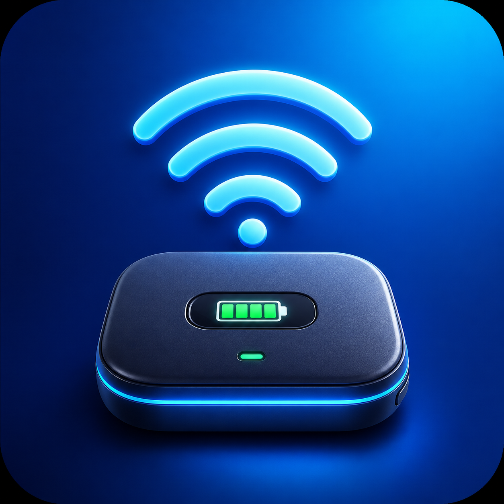

<div align="center">
  
  <h1>Mwifi</h1>
  <p>在 macOS 菜单栏查看 Wi-Fi 网速、流量与移动 WiFi 电量。</p>
  <p><strong>macOS 13+ · Apple Silicon · 原生 SwiftUI · 本地存储</strong></p>
  <p><a href="https://donga5.github.io/Mwifi/">应用主页与截图</a> · <a href="https://github.com/Donga5/Mwifi/releases/latest">下载安装包</a> · <a href="#安装与更新">安装说明</a> · <a href="#隐私与数据">隐私与数据</a> · <a href="https://github.com/Donga5/Mwifi/issues">反馈问题</a></p>
</div>

Mwifi 是一个轻量的 macOS 菜单栏应用：连接普通 Wi-Fi 或手机热点时，查看 Mac 的实时网速和累计流量；连接支持的中兴 U30 Air 时，还可查看设备电量、充电状态与运营商，并接收电量提醒。

**当前版本：`1.5.4`（构建号 `11`）**

## 功能

| 功能 | 说明 |
| --- | --- |
| 菜单栏状态 | U30 Air 显示电量；其他 Wi-Fi 显示当前下载速率，不占用 Dock |
| 实时网速 | 每秒采样本机 Wi-Fi 接口，分别显示上传、下载速率 |
| 流量统计 | 今日累计、月度汇总、按网络筛选及每日柱状图；保留最近 24 个月记录 |
| 网络识别 | 显示 SSID，区分手机热点和普通 Wi-Fi，支持手动修正并记住分类 |
| 电量与充电 | 电池填充与实际百分比一致；充电显示闪电，低于 30% 时填充变黄 |
| 电量提醒 | 默认低于或达到 20%、10% 时提醒；充电首次达到 60% 时提醒，按周期去重 |
| 自动恢复 | 电量读取失败后每 30 秒重试；成功后恢复每 5 分钟检查，也支持立即刷新 |
| 系统集成 | 支持登录时启动、系统通知、深色与浅色外观 |

低电量和紧急电量阈值可调整；电池的 30% 黄色提示独立于通知阈值。

## 兼容性

- **系统：** macOS 13 Ventura 或更高版本。
- **处理器：** 当前安装包和构建脚本仅支持 Apple Silicon（arm64），不提供 Intel 安装包。
- **网速与流量：** 适用于 Mac 当前连接的 Wi-Fi，包括手机热点与普通路由器。
- **设备电量：** 面向提供兼容只读接口的中兴 U30 Air，管理地址需为 `http://192.168.0.1`。不同固件的兼容性可能不同。
- **其他设备：** 手机热点和普通 Wi-Fi 通常没有可读取电量的通用接口，Mwifi 会显示“电量不可读取”。

## 安装与更新

1. 从 [GitHub Releases](https://github.com/Donga5/Mwifi/releases/latest) 下载 `Mwifi-1.5.4-arm64.dmg`。
2. 如果旧版正在运行，先从菜单中选择“退出”。
3. 打开 DMG，把 **Mwifi.app** 拖到 **Applications**，更新时替换旧版。
4. 从“应用程序”打开 Mwifi，按系统提示授予相关权限，然后推出磁盘映像。

应用启动后位于屏幕右上角菜单栏，没有 Dock 图标。替换应用不会主动删除本地流量数据库。

### 首次打开

当前分发版使用 **ad-hoc 临时签名**，尚未使用 Apple Developer ID 签名或 Apple 公证，因此 macOS 可能阻止首次打开。

确认安装包来自本仓库后，先尝试打开应用，再到“系统设置 → 隐私与安全性”选择“仍要打开”。具体提示和步骤参见 [Apple 官方说明](https://support.apple.com/zh-cn/102445)。

### 权限说明

| 权限 | 用途 |
| --- | --- |
| 位置 | 通过系统接口读取当前 Wi-Fi 名称，用于网络分类和流量归属 |
| 本地网络（系统提示时） | 访问 U30 Air 的本地状态接口 |
| 通知 | 发送低电量、紧急电量和充电达到 60% 的提醒 |

### 校验下载

Release 同时提供 `.sha256` 校验文件。将它与 DMG 下载到同一文件夹，在该文件夹运行：

```bash
shasum -a 256 -c Mwifi-1.5.4-arm64.dmg.sha256
```

输出 `OK` 表示文件与发布时的 SHA-256 一致。

## 使用方法

- 点击菜单栏图标，查看当前网络、设备状态、运营商、双向速率与今日流量。
- 点击“查看流量详情”，按月份查看所有网络或单个 Wi-Fi 的每日流量。
- 当前月份显示截至当前日期的累计流量；历史月份显示该月记录的总量。
- 网络被误判时，手动修改网络类别；应用按 Wi-Fi 名称记住选择。
- 点击“立即刷新”可重新探测设备状态，不必切换 Wi-Fi 或重启应用。
- 在菜单中调整提醒阈值，或管理“登录时启动”。从 `/Applications` 首次启动时，应用会尝试默认启用登录启动，可在菜单中关闭。

### 统计范围

流量统计仅包含 **Mwifi 运行期间，本机 Wi-Fi 接口收发的数据**，不是 SIM 套餐的计费流量，也不包含同一网络中的其他设备。退出应用、Mac 关机期间的流量无法补算。

记录按 Wi-Fi 名称（SSID）区分网络：同名接入点会作为同一个逻辑网络汇总。未授权读取 SSID 时，应用无法准确区分网络。

实时速率使用十进制 `MB/s`：`1 MB/s = 1,000,000 bytes/s`。大于零但不足 `0.01 MB/s` 时显示为 `<0.01 MB/s`。

## 隐私与数据

- 无需账号，不保存路由器后台密码，不包含广告、分析或遥测服务。
- 路由器状态请求发往本地地址 `192.168.0.1`；应用不向第三方服务器上传设备状态、网络名称或流量记录。
- 流量数据库位于 `~/Library/Application Support/Mwifi/traffic.sqlite`，包含日期、Wi-Fi 名称、网络类别和收发字节数。
- 提醒阈值、提醒状态和手动网络分类保存在本机偏好设置中。
- 发布包仅包含应用程序、图标与必要元数据，不包含开发机器的配置、日志或用户流量数据库。

提交问题时，请先遮盖截图中的 Wi-Fi 名称等个人信息，不要上传实际流量数据库、密码或令牌。

## 从源码构建

需要 Apple Silicon Mac、Apple Command Line Tools，以及支持 Swift 6 的编译器。先安装或更新工具：

```bash
xcode-select --install
```

获取源码并验证：

```bash
git clone https://github.com/Donga5/Mwifi.git
cd Mwifi
./scripts/run-tests.sh
./scripts/build-app.sh
```

App 输出到 `dist/Mwifi-1.5.4.app`，脚本会进行优化编译、临时签名和签名完整性校验。版本号来自 `Resources/Info.plist`。

若默认 SDK 报 `SwiftUIMacros.StateMacro` 插件缺失，请使用配套完整的 Xcode 工具链，或通过 `MWIFI_SDK` 选择已安装的兼容 SDK。例如安装了 macOS 26.5 SDK 时：

```bash
MWIFI_SDK=macosx26.5 ./scripts/run-tests.sh
MWIFI_SDK=macosx26.5 ./scripts/build-app.sh
```

生成可分发的 DMG 和校验文件：

```bash
./scripts/package-release.sh
```

输出：

```text
dist/Mwifi-1.5.4.app
dist/Mwifi-1.5.4-arm64.dmg
dist/Mwifi-1.5.4-arm64.dmg.sha256
```

脚本拒绝覆盖已有的同版本产物。发布新构建时，先递增版本号与构建号，并同步更新本文；本地开发需要重新编译时，可自行移走旧的本地产物。已经发布的版本号和标签不可复用。

### 验证范围

`run-tests.sh` 使用模拟路由器响应、独立测试偏好设置和内存数据库，覆盖电量/运营商解析、提醒去重与重试、网络分类、网速换算、流量累计、跨日记录、月度汇总及设备探测恢复。测试不需要连接真实路由器。

该脚本是项目的常规验证入口。自动化测试不等于对所有路由器固件、macOS 权限流程和通知投递的实机验证。

### 项目结构

```text
Resources/             应用图标与 Info.plist
Sources/Mwifi/         SwiftUI 界面、网络探测、电量提醒和流量存储
Tests/                 测试入口与 XCTest 用例
scripts/build-app.sh   构建并验证临时签名的 App
scripts/run-tests.sh   运行项目测试
scripts/package-release.sh  生成 DMG 与 SHA-256 校验文件
dist/                  本地发布产物，不纳入 Git
```

### 本地设备接口

```text
GET http://192.168.0.1/goform/goform_get_cmd_process
```

应用读取电量、充电状态、运营商及设备返回的速率字段，例如 `battery_vol_percent`、`battery_charging`、`network_provider_fullname` 和 `flux_realtime_*_thrpt`，并保留部分中兴固件字段的兼容回退。界面中的网速与累计流量以本机 Wi-Fi 接口采样为准。应用不修改路由器配置。

## 常见问题

**显示“未连接”或无法读取电量？** 先确认 Mac 已连接目标 Wi-Fi，并能在浏览器访问 `http://192.168.0.1`；检查本地网络权限，再点击“立即刷新”。非兼容设备仅提供网络和流量功能。

**Wi-Fi 名称无法显示？** 检查“系统设置 → 隐私与安全性 → 定位服务”中的 Mwifi 权限，重新打开应用后查看。

**网速一直为零？** 确认实际流量经过 Wi-Fi 接口，并正在进行下载或其他网络活动。更新后请确认旧进程已退出。

**没有收到电量提醒？** 在“系统设置 → 通知 → Mwifi”中开启通知和声音，并检查专注模式。提醒只在兼容设备电量可读取时生效。

**流量与运营商账单不一致？** Mwifi 统计本机接口收发数据，统计范围与运营商计费口径不同，不能代替套餐账单。

仍有问题可提交 [GitHub Issue](https://github.com/Donga5/Mwifi/issues)，附上 macOS 版本、Mwifi 版本、设备型号和复现步骤。

## 更新记录

### 1.5.4

- 首次通过 GitHub Release 提供 DMG 安装包和 SHA-256 校验文件。
- 完善安装、兼容性、权限、隐私、构建及故障排查文档。
- 将测试网络名称替换为通用样例；源码仓库排除本地数据和构建产物。
- 发布脚本校验版本和签名，避免覆盖已有同版本产物。
- 构建和测试支持通过 `MWIFI_SDK` 选择已安装的 macOS SDK。

### 1.5.3

细化电池图标线条、比例、圆角和充电闪电；低于 30% 时仅内部填充变黄，外框与百分比保持系统颜色，适配深浅色外观。

### 1.5.2

修复首次读取电量失败后无法恢复的问题；失败后每 30 秒自动重试，“立即刷新”强制重新识别，成功后恢复完整电量信息。

### 1.5.1

电池图标按实际电量填充，修复充电时始终显示满电的问题，并保留充电标记。

### 1.5.0

加入 SQLite 持久化流量统计、月度汇总、网络筛选与每日柱状图。后续维护中完善了通知失败重试和本月统计范围说明。

## 发布约定

### 项目网站

应用介绍与截图位于 [Mwifi 主页](https://donga5.github.io/Mwifi/)，使用 GitHub Pages 从 `main` 分支的 `/docs` 目录自动发布。网站使用纯 HTML、CSS 和 JavaScript，无需安装前端依赖。

本地预览：

```bash
python3 -m http.server 8765 --bind 127.0.0.1 --directory docs
```

然后在浏览器打开 `http://127.0.0.1:8765/`。修改 `docs/` 并推送到 `main` 后，GitHub 会更新网站。截图复用原生 SwiftUI 界面并使用演示数据，来源说明见 `docs/assets/README.md`。发布新的应用版本时，需要同步更新网页中的版本说明；主要下载按钮始终指向最新 Release。

### 应用版本

使用 `MAJOR.MINOR.PATCH` 版本号；每次发布同步更新 `CFBundleShortVersionString`、递增的 `CFBundleVersion`、README 和产物名称。测试、构建、签名与安装包检查通过后，创建对应的 annotated tag `v<版本号>`。

GitHub Release 上传 DMG 和 SHA-256 文件，不另行制作 ZIP 安装包。发布前检查源码、提交元数据和安装包，不提交数据库、真实网络名称、私人邮箱、凭据、缓存或日志。
